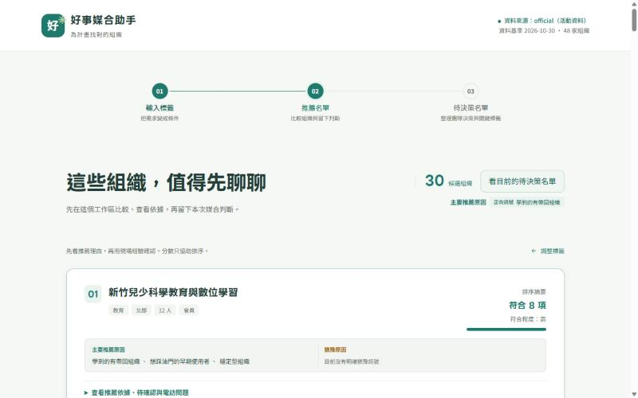

# 好事媒合助手

**把企業的一句話需求，幾分鐘內變成一份「附依據」的公益組織候選名單。**

### 👉 [線上試用](https://ry231111.github.io/-05-demo/)　免安裝、免登入，點開就能用

[](https://ry231111.github.io/-05-demo/)

> 數聚村莊《好事在數聚村莊｜數位快閃 AI Impact Day》黑客松（2026/11）· 分場 A「好事大平台」小組作品。資料皆為主辦方提供的虛構資料。

---

## 解決什麼問題

好事大平台的 PM 接到企業需求（例如「想陪跑 10 家有基本行銷能力的組織」）時，過去要翻 Ragic、SharePoint、LINE 對話，再去問資深顧問，**找出第一波名單要好幾天**，而且判斷只存在資深顧問腦中。

這個工具讓 PM：

1. **輸入一句話需求** → 自動轉成可調整的篩選條件
2. **拿到候選名單** → 每家附「為什麼推薦／要注意什麼／電訪先問什麼」，**每條理由都能點回原始紀錄**
3. **勾選符合／不符合** → 系統比對選中與淘汰的組織，學出偏好並自動補位
4. **輸出待決策名單（Excel）**，或產生給 Claude 的提示詞，貼回後**自動檢查引用的紀錄編號是否真的存在**

## 設計重點

- **可解釋，不是黑箱**：把訪談中資深顧問的經驗寫成 [18 條判斷規則](rules/rules.json)（訊號 → 解讀 → 行動），畫面顯示的是理由，不只是分數。
- **AI 只用在該用的地方**：建置時用 LLM 從顧問筆記等自由文字抽取標籤，每個標籤都必須附原文引用、通過驗證才採用；網頁本身不呼叫 AI。
- **資料跟著組織走**：每家組織彙整成一份檔案，PM 回饋也寫回組織，而不是留在個人手上。
- **資料與規則分離**：換資料來源只改 [`config/columns.json`](config/columns.json)，不用動到網頁程式；比賽當天就是這樣接上主辦方的官方資料。

## 團隊

方向由三人共同討論決定。

| 成員 | 負責 |
|---|---|
| **Roy** | 系統設計、以 AI 輔助開發實作整個系統 |
| **Agnes** | 系統設計、使用者體驗、成果發表 |
| **Jane** | 前端介面 |

## 技術

純靜態網頁（HTML / CSS / 原生 JavaScript），部署在 GitHub Pages，無後端、無資料庫。

```
CSV 原始資料 ──► scripts/build.py ──► output/bundle.js ──► web/（瀏覽器內篩選、評分、重排）
                     ▲
       LLM 抽取標籤（附原文、build 時驗證）
```

| 位置 | 內容 |
|---|---|
| [`web/`](web/) | 網頁；篩選引擎 [`engine.js`](web/engine.js) 與畫面 [`app.js`](web/app.js) 分開 |
| [`scripts/`](scripts/) | 資料健檢、建置（Python 標準函式庫）、冒煙測試（Node） |
| [`rules/`](rules/) | 判斷規則與需求條件 |
| [`docs/訪談對照.md`](docs/訪談對照.md) | 訪談 → 痛點 → 設計的對照 |
| [`docs/開發說明.md`](docs/開發說明.md) | 完整開發文件：資料流程、欄位對照、導入官方資料步驟 |

### 本機執行

```bash
python -m http.server 8765
```

開啟 http://localhost:8765/web/ 。重新建置資料：`python scripts/build.py`；測試：`node scripts/check.js`。
